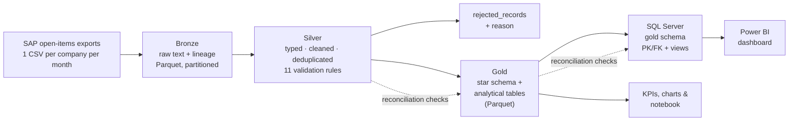
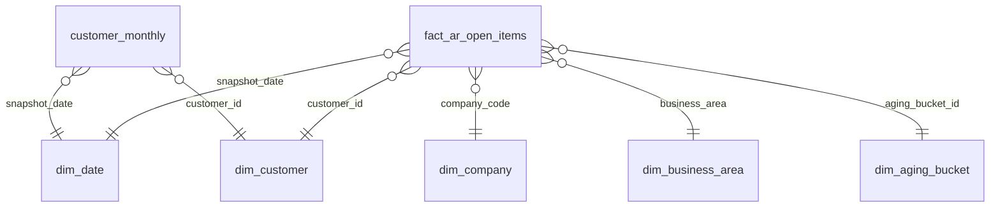
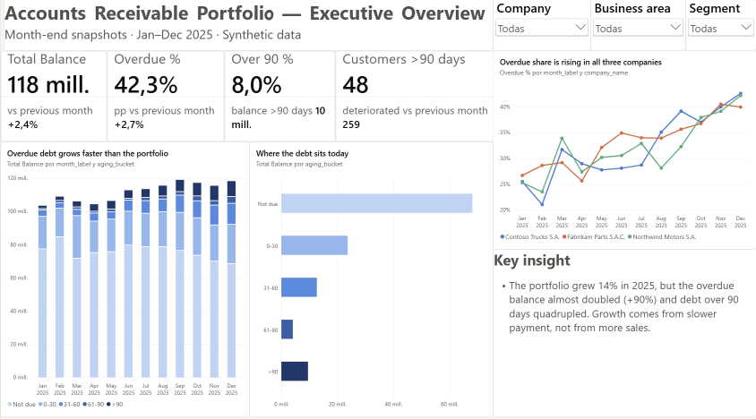
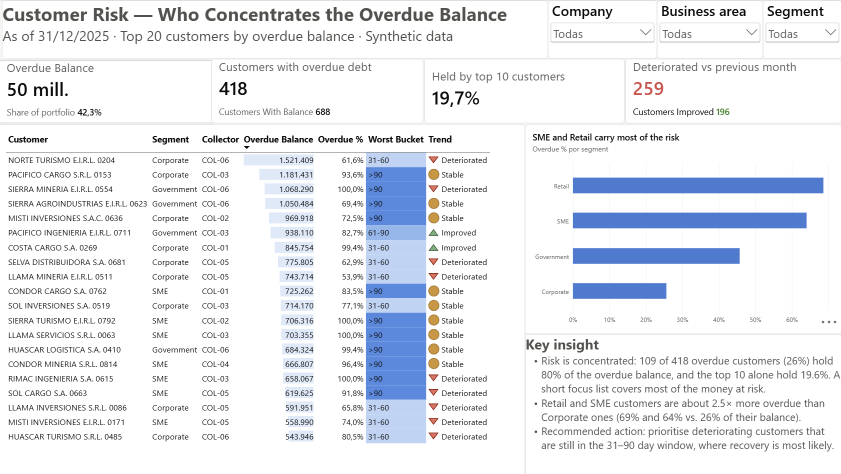
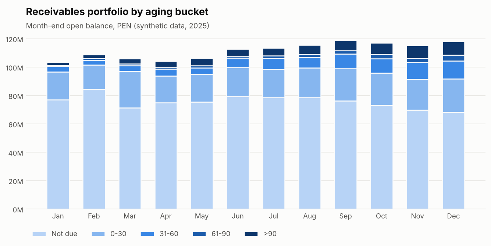
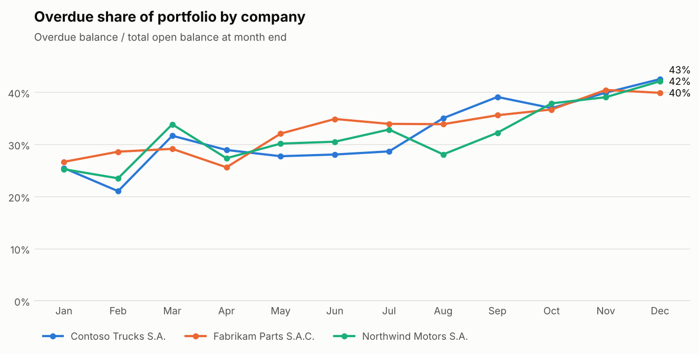
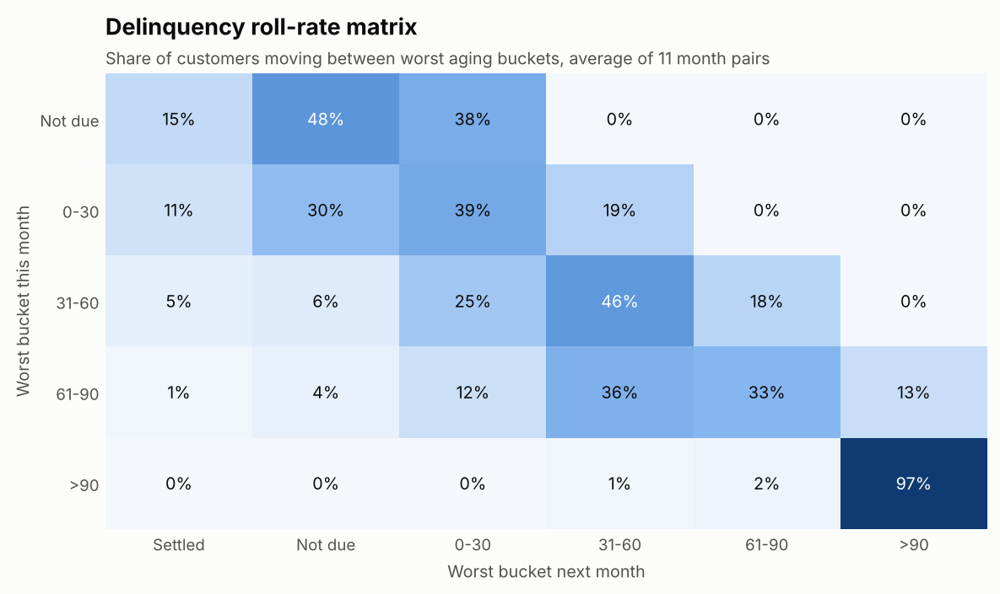
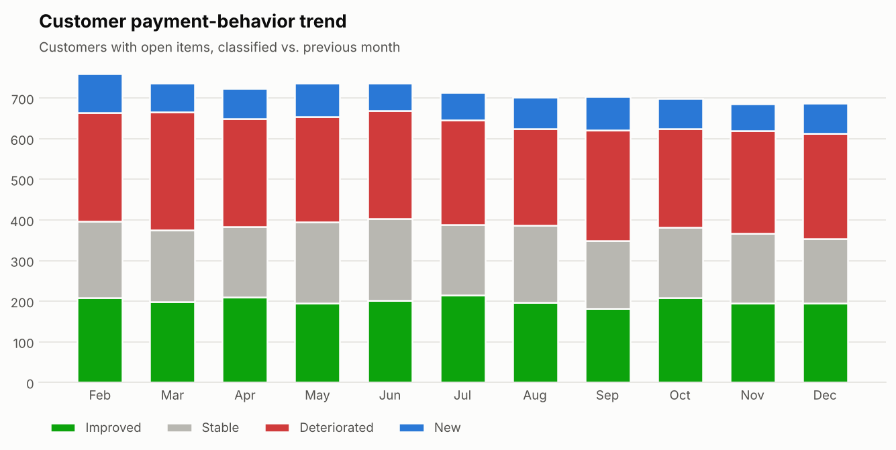

# Accounts Receivable Analytics & ETL Pipeline

**From raw SAP receivables exports to a trusted, historical portfolio view — built with a Medallion architecture (Bronze → Silver → Gold) on DuckDB and Parquet, served from SQL Server to Power BI.**


> **All data in this repository is synthetic.** Companies, customers and amounts are generated by
> [`generate.py`](src/ar_pipeline/generate.py). The business rules are generic credit-and-collections
> practice; no confidential information from any employer is included.

---

## 1. Project Overview

Collections teams often track receivables in spreadsheets rebuilt by hand every month: one export per
company, copied, filtered and pivoted. The result is slow, error-prone and has no memory — last month's
picture is overwritten, so nobody can say whether a customer is getting better or worse.

This project replaces that process with a reproducible pipeline that:

- ingests monthly SAP open-items exports for several companies without ever overwriting history,
- validates and cleans every row, keeping rejected records and the reason they were rejected,
- builds a star schema and analytical tables (aging, customer trend, roll rates),
- publishes them to **SQL Server** with primary keys, foreign keys, check constraints and reporting views, where Power BI connects,
- reconciles row counts and amounts between layers and **fails loudly** if anything is lost.

One command runs the whole flow in a few seconds: `python -m ar_pipeline.run`.

## 2. Business Problem

A group of three companies sells vehicles, parts and services on credit. Finance needs to answer, every month:

1. How much money is outstanding, and how much of it is overdue?
2. Is portfolio quality improving or deteriorating — and in which company, segment or collector?
3. Which customers concentrate the risk?
4. Once a customer falls behind, how likely is it to recover?

## 3. Objectives

- Automate the monthly consolidation of receivables from several source files.
- Guarantee data quality with explicit, testable rules and full traceability.
- Keep an immutable monthly history to measure trends and transitions over time.
- Deliver a Power BI–ready model and decision-oriented KPIs.

## 4. Dataset Description

| Item | Detail |
|---|---|
| Source format | SAP-style open-items export (`;`-separated CSV, `dd.mm.yyyy` dates, trailing minus for credit notes) |
| Files | 36 = 3 companies × 12 month-end snapshots (Jan–Dec 2025) |
| Rows | 37,251 raw rows · 900 customers · ~29,000 simulated documents |
| Companies | Northwind Motors S.A., Contoso Trucks S.A., Fabrikam Parts S.A.C. (fictional) |
| Columns | company, customer, segment, document number and type, business area, posting date, due date, amount, currency, days in arrears, collector |
| Injected issues | duplicates, missing customers, due date before posting date, zero amounts, days-in-arrears inconsistencies, messy names |

A 40-row extract is available in [`data/sample/`](data/sample/). The generator models customer segments,
payment-delay profiles and trends (improving / stable / deteriorating), so the analysis has real signal to find.

## 5. Tools & Technologies

| Layer | Tools |
|---|---|
| Processing & SQL | Python, DuckDB (SQL engine), pandas, NumPy |
| Storage | Apache Parquet (Hive-partitioned Bronze) |
| Serving | SQL Server (T-SQL: star schema with PK/FK/CHECK constraints, indexes, views, window functions), pyodbc |
| Quality | Rule-based validation, reconciliation checks, pytest |
| Analysis | Jupyter, matplotlib |
| BI | Power BI (star schema + semi-additive DAX measures) |

## 6. Methodology

**Bronze — land it as is.** Every column is stored as text so nothing is lost on ingestion. Lineage columns
(`_source_file`, `_ingested_at`) are added, and the snapshot date and company come from the file name.
Files with an unexpected name or schema go to quarantine instead of breaking the run. **An existing
snapshot is never overwritten** unless `--regenerate` is used.

**Silver — make it trustworthy.** Typing (dates, decimals, SAP trailing minus), text normalisation and
deduplication, then 11 ordered validation rules. Each raw row ends up in exactly one place:
`ar_open_items` (accepted) or `rejected_records` (with the first rule it broke).
SAP's *days in arrears* is the official aging value; the pipeline recalculates it from the dates **only as a
control** and flags mismatches instead of silently "fixing" them.

**Gold — make it useful.** A star schema at document × snapshot grain, plus three analytical tables:

- `agg_portfolio_monthly` – balance by month, company, business area and aging bucket
- `customer_monthly` – worst aging bucket per customer and month, and its trend vs. the previous month
  (*Improved / Stable / Deteriorated / New*)
- `bucket_transitions` – month-over-month movement between aging buckets (roll rates)

Credit notes reduce balances but never define how late a customer is.

**Serving — SQL Server.** The Gold tables are published to the `gold` schema of a SQL Server database
([`sql/`](sql/)). The database enforces the model on its own: primary keys on every table, foreign keys
from facts to dimensions, and check constraints (no zero amounts, due date after posting date, valid trend
labels). The load is a **full refresh inside a single transaction**, followed by a row-count and amount
reconciliation against the Parquet files; if anything differs, the transaction is rolled back and the
database is left untouched. Reporting views (`vw_kpi_monthly`, `vw_portfolio_monthly`,
`vw_customer_risk_latest`) and [analysis queries](sql/04_analysis_queries.sql) (Pareto, roll-rate `PIVOT`,
collector ranking with window functions) answer the business questions directly in T-SQL.

## 7. Architecture



**Gold star schema**



**Project structure**

```
├── config/pipeline.yaml        # paths, companies, aging buckets, thresholds (no logic)
├── src/ar_pipeline/
│   ├── generate.py             # synthetic SAP-style exports with injected quality issues
│   ├── bronze.py               # raw ingestion, lineage, quarantine, no-overwrite rule
│   ├── silver.py               # typing, cleaning, dedup, validation rules, aging
│   ├── gold.py                 # star schema + analytical tables
│   ├── quality.py              # reconciliation checks and data quality report
│   ├── analytics.py            # KPIs and charts
│   ├── load_sqlserver.py       # transactional load of Gold into SQL Server + reconciliation
│   └── run.py                  # orchestrates the full pipeline
├── sql/                        # T-SQL: database, gold star schema, reporting views, analysis queries
├── tests/                      # 27 pytest tests (transformations, loader, T-SQL/DDL consistency)
├── notebooks/                  # portfolio analysis on the Gold layer
├── powerbi/                    # DAX measures and dashboard build guide
├── data/gold/                  # Gold tables (versioned so you can explore without running)
└── reports/                    # data quality report and KPI summary (generated)
```

## 8. Key Findings

### Power BI dashboard

Built on the SQL Server serving layer (star schema + semi-additive DAX measures). File: [`powerbi/ar_portfolio_dashboard.pbix`](powerbi/).

**Executive overview** — portfolio size, overdue share and month-over-month change



**Customer risk** — who concentrates the overdue balance, by segment and trend



### Analysis results

*Figures computed from the synthetic dataset (Jan → Dec 2025). They illustrate the analysis; they do not describe a real company.*

| KPI | Jan 2025 | Dec 2025 | Change |
|---|---:|---:|---:|
| Total open balance | PEN 103.4 M | PEN 118.2 M | +14% |
| Overdue balance | PEN 26.3 M | PEN 50.0 M | **+90%** |
| Overdue share | 25.4% | 42.3% | +16.9 pp |
| Balance > 90 days share | 1.9% | 8.0% | ×4 |
| Customers > 90 days | 36 | 48 | +12 |



1. **Receivables grew because customers paid later, not because sales grew.** The open balance rose 14%, but
   the overdue balance almost doubled and the >90-day share quadrupled.



2. **The deterioration is group-wide**, not a single company's problem: all three companies end the year
   between 40% and 43% overdue.

3. **Risk sits with SME and Retail customers.** In December, 64% (SME) and 69% (Retail) of their balance was
   overdue and 14% was over 90 days, versus 26% and 3% for Corporate customers.

4. **Risk is concentrated.** 109 of 418 overdue customers (26%) hold 80% of the overdue balance.



5. **Timing decides recovery.** Of customers whose worst bucket is 0–30 days, 42% are current or settled a
   month later and 19% roll to 31+ days. Once a customer reaches **>90 days, 97% are still there the next
   month.**



6. **Collector portfolios differ sharply:** the overdue share ranges from 30% to 58% across collectors,
   which points to workload or segment-mix imbalances worth reviewing.

**Data quality** ([full report](reports/data_quality_report.md)): 256 of 37,251 raw rows (0.69%) were
rejected — 148 duplicates, 45 missing customers, 32 invalid due dates, 31 zero amounts — and 117 rows were
flagged for a days-in-arrears mismatch with SAP. All 7 reconciliation checks pass.

## 9. Business Recommendations

1. **Act in the 31–90 day window.** Recovery probability collapses after 90 days; a weekly focus list of
   *deteriorating* customers in 31–90 days (see the notebook) targets the money that can still be saved.
2. **Review credit terms for SME and Retail**, where overdue exposure is two to three times that of
   Corporate customers: shorter terms, deposits or credit limits tied to payment behavior.
3. **Prioritise by concentration.** A short list of ~100 customers covers 80% of the overdue balance; assign
   them named owners and track promises to pay.
4. **Rebalance collector portfolios** using the overdue share and the number of deteriorating customers per
   collector, not just the number of accounts.
5. **Fix data at the source.** Share the rejected-records file and days-in-arrears mismatches with the SAP
   owner every month so quality improves upstream.

## 10. How to Run

```bash
git clone https://github.com/Raul9915/accounts-receivable-analytics-pipeline.git
cd accounts-receivable-analytics-pipeline
python -m venv .venv && source .venv/bin/activate      # Windows: .venv\Scripts\activate
pip install -r requirements.txt

python -m ar_pipeline.run              # generates data if needed and runs Bronze -> Silver -> Gold
python -m ar_pipeline.run --regenerate # rebuild everything from scratch
python -m pytest                       # run the test suite
```

> If your environment does not install the package, prefix commands with `PYTHONPATH=src`
> (Windows PowerShell: `$env:PYTHONPATH="src"`), or run `pip install -e .`.

Outputs: Gold tables in `data/gold/`, data quality report and KPIs in `reports/`, charts in `images/`.

### Publish to SQL Server (Windows)

Requirements: SQL Server (Developer or Express edition), SSMS, and
[ODBC Driver 18 for SQL Server](https://learn.microsoft.com/sql/connect/odbc/download-odbc-driver-for-sql-server).

```powershell
pip install -r requirements-sqlserver.txt

# Optional: point to your instance (default is localhost with Windows authentication)
$env:AR_SQL_SERVER = "localhost\SQLEXPRESS"

python -m ar_pipeline.load_sqlserver --init   # first time: creates ARAnalytics, gold tables and views
python -m ar_pipeline.load_sqlserver          # afterwards: reload after each pipeline run
```

Credentials are never stored in the repository: connection settings come from `config/pipeline.yaml`
and can be overridden with `AR_SQL_SERVER`, `AR_SQL_DATABASE`, `AR_SQL_USER` and `AR_SQL_PASSWORD`.
The scripts in [`sql/`](sql/) can also be run manually in SSMS in numeric order.

To build the dashboard on top of SQL Server, follow [`powerbi/README.md`](powerbi/README.md).

## 11. Limitations & Next Steps

- **Synthetic data:** realistic by design, but real portfolios have seasonality, partial payments and
  disputes that are not modelled.
- **No payment-clearing data:** the pipeline infers that a customer settled because its items disappear
  from the next snapshot. A clearing-documents extract would make collection effectiveness measurable.
- **Full refresh:** the SQL Server load replaces all Gold tables each run, which is simple and safe at
  this volume; at larger scale it would switch to incremental loads per snapshot.
- **Local execution:** DuckDB + Parquet runs on a laptop or a shared folder, and SQL Server runs locally.
  The same layers could move to a cloud platform (e.g. Azure SQL or Microsoft Fabric) with minimal changes.

Next steps: roll-rate and collector pages in Power BI, a delinquency prediction model on top of
`customer_monthly` (see *Credit Risk & Delinquency Analytics*), and scheduled runs with logging alerts.

---

**Author:** Raul Mendoza Sotomayor · [LinkedIn](https://www.linkedin.com/in/raul-mendoza-sotomayor) · [GitHub](https://github.com/Raul9915)
